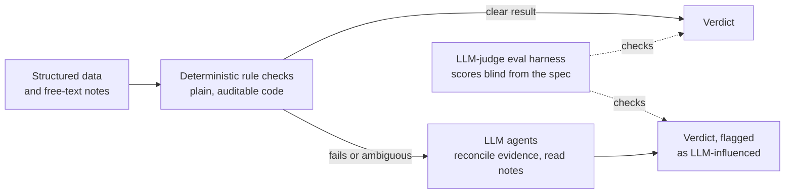

# Ojasvi Tewari

Forward Deployed AI Engineer. I build LLM agent systems for regulated data.

- Forward Deployed AI Engineer at a healthcare AI startup from July 2025 to October 2026, after a 10-month internship there
- B.S. Computer Science, UC San Diego, 2025
- Based in Boston, MA. Open to forward deployed, applied AI and solutions engineering roles in New York or Boston
- [LinkedIn](https://www.linkedin.com/in/ojasvi-tewari) · [Devpost: Break It](https://devpost.com/software/break-it)

## How I build agent systems

Most of my professional code is in private repositories, so here is the pattern rather than the source.

- **Deterministic first.** Rule checks run as plain, auditable code. LLM agents step in only when the evidence is ambiguous or sits in free-text notes.
- **Flag every LLM-influenced result.** A reviewer can always see where a model was involved.
- **Evaluate before trusting.** Independent LLM judges score cases blind from the written specification.

Where I used it:

- Led development of a clinical quality-measure platform: HEDIS and MIPS measures modeled as a Neo4j semantic layer and executed by a LangGraph multi-agent engine over patient knowledge graphs
- Built a 15-agent Pydantic AI engine with GraphRAG retrieval, later repurposed into the medical-coding review product that anchors customer demos
- Validated the engine with an LLM-judge eval harness: independent judge agents scored 50 patients blind from the official HEDIS specification at 100% agreement, surfacing 3 engine bugs and 1 spec-interpretation error
- Re-architected a clinical compliance app solo, from a TypeScript monolith to FastAPI and React

## Projects

| Project | What it is |
|---|---|
| [Break It](https://devpost.com/software/break-it) | A red-teaming platform for AI agents. An LLM pipeline finds prompt-injection, tool-misuse and data-exfiltration vulnerabilities in an uploaded agent, builds gamified exploit levels from them and grades robustness A to F. Won the security track at SharkHack 2026 with a team of 5. I owned chat-log persistence, the user stats and profile system, leaderboard seeding and branding. |
| [SynapseShift-EEG-Control](https://github.com/OTewari/SynapseShift-EEG-Control) | A real-time brain-computer interface, built for the BCI course at UC San Diego. It classifies 8-channel EEG from an OpenBCI Cyton board into six classes, such as blink, jaw clench and eyes-closed relaxation, and presses a key for each. I used it to scroll YouTube Shorts hands-free. Common Spatial Patterns implemented from scratch, SVM and Keras classifiers, and a held-out evaluation: about 58% accuracy across six classes, against 17% chance. |
| [NeuralSymphonizer](https://github.com/OTewari/NeuralSymphonizer) | An LSTM that learns to continue classical piano music from MIDI. It began as a reproduction of a Keras tutorial and was improved one documented stage at a time: event tokens with timing, grammar-constrained sampling, training on MAESTRO, then LayerNorm and Adam. Written up as a short research paper, with 18 recordings to listen to. |

## Stack

Python · TypeScript · FastAPI · React · LangGraph · Pydantic AI · Neo4j and Cypher · PostgreSQL · Docker · pytest
